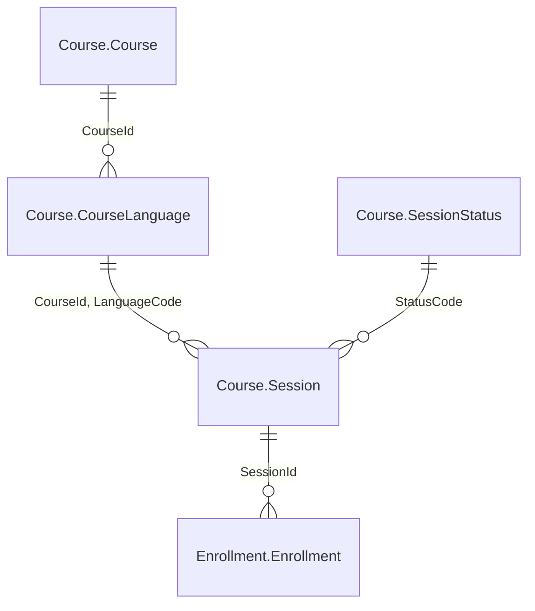

# Exercice du module 1

Le service planification a sa liste de la semaine. Pour répondre à un client, il lui faut
maintenant le détail d'une session : quel cours, quand, dans quel état, et combien de
stagiaires y sont inscrits. Vous ajoutez au serveur un second outil, `session_detail`.

## Le départ

Partez de la fin du module, votre branche `module-01`, ou l'étiquette du dépôt :

```bash
git switch -c exercise-01 module-01-end
uv sync
```

Le labo doit tourner (`./setup/install.sh`, puis `uv run python setup/check_lab.py`, qui
finit par `lab ok`).

## La demande

Un outil `session_detail(session_id: int)` dans `src/pachatraining_mcp/server.py`, qui rend
un modèle pydantic avec ces champs, et ces noms :

| Champ | Type | D'où il vient |
|---|---|---|
| `session_id` | `int` | `Course.Session.SessionId` |
| `course_code` | `str` | `Course.Course.Code` |
| `title` | `str \| None` | `Course.CourseLanguage.Title`, ligne `LanguageCode = 'EN'` |
| `start_date` | `date` | `Course.Session.StartDate` |
| `status` | `str` | `Course.Session.StatusCode`, sans les espaces de fin |
| `enrolled` | `int` | les lignes d'`Enrollment.Enrollment` de la session dont `CancellationDate` est vide |



La clé étrangère de la session vise la fiche du cours dans la langue de la session. Le titre
anglais se lit comme dans `sessions_in_week` : `Course.CourseLanguage` joint sur `CourseId`
et `LanguageCode = 'EN'`.

Les consignes :

1. Une requête paramétrée (`?`), comme celle de `sessions_in_week` : l'identifiant ne se
   colle jamais dans le texte SQL.
2. Une inscription annulée ne compte pas. La session 17709 n'en a aucune, la 17719 en a une
   sur quatre : c'est elle qui montre si le filtre manque.
3. Une session qui n'existe pas rend une erreur. Une exception levée dans
   l'outil suffit pour l'instant ; le module 3 montre comment rendre son message lisible
   par le modèle.
4. Les tests du module passent toujours (`uv run pytest -q`).

Pour comparer, la requête de contrôle, lancée en `sa` dans le conteneur comme le fait
`setup/` (le serveur, lui, ne se connecte jamais en `sa`) :

```bash
docker compose exec sql /opt/mssql-tools18/bin/sqlcmd -S localhost -U sa -C -d PachadataTraining -Q "SELECT SessionId, COUNT(*) AS enrolled FROM Enrollment.Enrollment WHERE SessionId IN (17709, 17719) AND CancellationDate IS NULL GROUP BY SessionId"
```

Avec Podman : `podman exec -i mcpcourse` à la place de `docker compose exec sql`. Sur le labo,
elle rend 6 pour 17709 et 3 pour 17719.

## Le critère

```bash
bash exercises/module_01/check.sh
```

Le script lance pytest sur `exercises/module_01/test_session_detail.py`, avec le client du
SDK en mémoire, sans modèle ni Node. Il attend quatre tests passés, et échoue sur tout autre
nombre :

- `session_detail` est listé, avec `session_id` obligatoire et de type entier ;
- la session 17709 rend `LNX-ADM2`, son titre anglais, le 16 novembre 2026, `CONFIRMED`, et
  6 inscrits ; la 17719 en rend 3 ; les deux nombres sont aussi relus dans la base ;
- la session 99999 rend une erreur venue de l'outil ;
- `sessions_in_week` rend toujours ses 36 sessions.

La dernière ligne doit être `All 4 checks passed.`

Ensuite, dans `~/pachadata-host`, relancez `claude` : `/mcp` montre maintenant deux outils.
Posez la question, par exemple « Combien de stagiaires sont inscrits à la session 17719 ? »,
et comparez la réponse au résultat de la requête de contrôle.

Une solution est dans `exercises/module_01/solution/`.

---

# Module 1 exercise

The planning team has its list of the week. To answer a customer, it now needs the detail of
one session: which course, when, in what state, and how many trainees are enrolled. Add a
second tool to the server, `session_detail`.

Start from the end of the module (`git switch -c exercise-01 module-01-end`, then `uv sync`),
with the lab running. The tool `session_detail(session_id: int)` returns a pydantic model with
the fields `session_id`, `course_code`, `title` (English title, `Course.CourseLanguage` with
`LanguageCode = 'EN'`), `start_date`, `status` (trailing spaces removed) and `enrolled` (rows
of `Enrollment.Enrollment` for the session whose `CancellationDate` is null). Use a
parameterized query. A cancelled enrollment does not count: session 17719 has one out of
four. A session that does not exist returns an error, not an empty object. The module tests
keep passing.

The control query, run as `sa` inside the container like `setup/` does (the server never
connects as `sa`), returns 6 for 17709 and 3 for 17719:

```bash
docker compose exec sql /opt/mssql-tools18/bin/sqlcmd -S localhost -U sa -C -d PachadataTraining -Q "SELECT SessionId, COUNT(*) AS enrolled FROM Enrollment.Enrollment WHERE SessionId IN (17709, 17719) AND CancellationDate IS NULL GROUP BY SessionId"
```

The check is `bash exercises/module_01/check.sh`: pytest with the in-memory SDK client, no
model, no Node, four tests expected, and any other number fails. Its last line must read
`All 4 checks passed.` A solution is in `exercises/module_01/solution/`.
