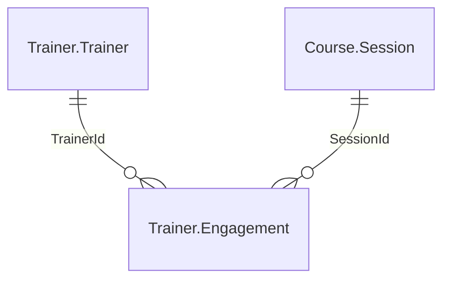

# Exercice du module 3

Le service planification veut connaître la charge d'un formateur sur un mois : combien de
sessions il anime, combien de jours il facture. Vous ajoutez au serveur un troisième outil,
`trainer_load`, avec un schéma d'entrée qui refuse un mois mal écrit, une sortie structurée et
une erreur que le modèle peut lire.

## Le départ

Partez de la fin du module, votre branche `module-03`, ou l'étiquette du dépôt :

```bash
git switch -c exercise-03 module-03-end
uv sync
```

Le labo doit tourner (`./setup/install.sh`, puis `uv run python setup/check_lab.py`, qui
finit par `lab ok`).

## La demande

Un outil `trainer_load` dans `src/pachatraining_mcp/server.py`, avec deux paramètres :

- `trainer_id`, un entier, l'identifiant de `Trainer.Trainer` ;
- `month`, le mois au format `AAAA-MM` (`2026-10`). Un `month: str` nu n'impose rien : le
  format se déclare dans le schéma, par `Annotated[str, Field(pattern=...)]`, pour qu'un
  `2026-13` soit refusé avant la fonction.

Il rend un modèle pydantic `TrainerLoad` avec ces champs, et ces noms :

| Champ | Type | D'où il vient |
|---|---|---|
| `trainer_id` | `int` | le paramètre |
| `month` | `str` | le paramètre |
| `sessions` | `int` | les lignes de `Trainer.Engagement` du formateur dont la session commence dans le mois |
| `days` | `float` | la somme de leur `DayCount` |



Une session appartient au mois de sa date de début, `Course.Session.StartDate`. Les sessions
et les jours se comptent dans la même table, `Trainer.Engagement`. `Course.Session.TrainerId`
donne un autre nombre (5 sessions pour le formateur 38 en octobre 2026, contre 3
engagements) : les engagements s'arrêtent au 15 octobre 2026 et ne couvrent pas toutes les
sessions. Octobre 2026 est le dernier mois qui en a.

Les consignes :

1. Une requête paramétrée (`?`), comme celles des deux autres outils.
2. Un formateur qui n'existe pas dans `Trainer.Trainer` rend une erreur qui le nomme, par
   `ToolError`. Un formateur qui existe et n'a rien dans le mois rend 0 session et 0 jour.
3. Une description pour l'outil, une pour chaque paramètre, un `title` et les annotations
   des deux autres outils : `tests/test_descriptions.py` vérifie tous les outils du serveur.
4. Les tests du module passent toujours (`uv run pytest -q`).

La requête de contrôle, lancée en `sa` dans le conteneur comme le fait `setup/` (le serveur,
lui, ne se connecte jamais en `sa`) :

```bash
docker compose exec sql /opt/mssql-tools18/bin/sqlcmd -S localhost -U sa -C -d PachadataTraining -Q "SELECT e.TrainerId, COUNT(*) AS sessions, SUM(e.DayCount) AS days FROM Trainer.Engagement AS e JOIN Course.Session AS s ON s.SessionId = e.SessionId WHERE e.TrainerId = 38 AND s.StartDate >= '2026-10-01' AND s.StartDate < '2026-11-01' GROUP BY e.TrainerId"
```

Avec Podman : `podman exec -i mcpcourse` à la place de `docker compose exec sql`. Sur le labo,
elle rend 3 sessions et 6.0 jours pour le formateur 38.

## Le critère

```bash
bash exercises/module_03/check.sh
```

Le script lance pytest sur `exercises/module_03/test_trainer_load.py`, avec le client du SDK
en mémoire, sans modèle ni Node. Il attend cinq tests passés, et échoue sur tout autre
nombre :

- `trainer_load` a un `outputSchema` qui nomme `trainer_id`, `month`, `sessions` et `days` ;
- `2026-13` est refusé par le schéma, avant la fonction : le message est celui de pydantic ;
- le formateur 999 rend une erreur venue de l'outil, dont le message contient `999` ;
- le formateur 38 en `2026-10` rend 3 sessions et 6.0 jours, relus aussi dans la base ;
- l'outil et chacun de ses deux paramètres ont une description.

La dernière ligne doit être `All 5 checks passed.`

Ensuite, dans `~/pachadata-host`, relancez `claude` : `/mcp` montre trois outils. Posez la
question, par exemple « Quelle est la charge du formateur 38 en octobre 2026 ? », et
regardez quel outil l'agent choisit.

Une solution est dans `exercises/module_03/solution/`.

---

# Module 3 exercise

The planning team wants the load of a trainer over one month: how many sessions they teach,
how many days they bill. Add a third tool to the server, `trainer_load`, with an input schema
that refuses a badly written month, a structured output, and an error the model can read.

Start from the end of the module (`git switch -c exercise-03 module-03-end`, then `uv sync`),
with the lab running. The tool takes `trainer_id` (an integer, the id of `Trainer.Trainer`)
and `month` (`YYYY-MM`, declared in the schema with `Annotated[str, Field(pattern=...)]`: a
bare `month: str` lets `2026-13` reach the function). It returns a pydantic model
`TrainerLoad` with the fields `trainer_id`, `month`, `sessions` (rows of `Trainer.Engagement`
for the trainer whose session starts in the month, `Course.Session.StartDate`) and `days` (the
sum of their `DayCount`). Count sessions and days in the same table: `Course.Session.TrainerId`
gives another number, because engagements stop on 15 October 2026. Use a parameterized query.
A trainer missing from `Trainer.Trainer` raises a `ToolError` that names it; an existing
trainer with nothing in the month returns zeros. The tool, each parameter, a `title` and the
annotations of the other tools are required: `tests/test_descriptions.py` checks every tool.
The module tests keep passing.

The control query, run as `sa` inside the container like `setup/` does (the server never
connects as `sa`), returns 3 sessions and 6.0 days for trainer 38:

```bash
docker compose exec sql /opt/mssql-tools18/bin/sqlcmd -S localhost -U sa -C -d PachadataTraining -Q "SELECT e.TrainerId, COUNT(*) AS sessions, SUM(e.DayCount) AS days FROM Trainer.Engagement AS e JOIN Course.Session AS s ON s.SessionId = e.SessionId WHERE e.TrainerId = 38 AND s.StartDate >= '2026-10-01' AND s.StartDate < '2026-11-01' GROUP BY e.TrainerId"
```

The check is `bash exercises/module_03/check.sh`: pytest with the in-memory SDK client, no
model, no Node, five tests expected, and any other number fails. Its last line must read
`All 5 checks passed.` A solution is in `exercises/module_03/solution/`.
