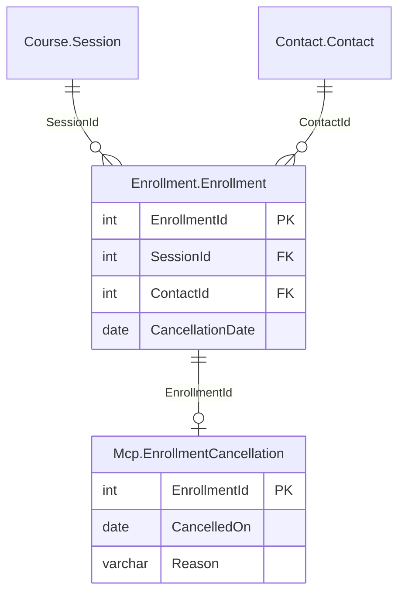

# Exercice du module 7

Le service des inscriptions veut annuler une inscription depuis Claude Code, comme la
planification reporte une session : jamais sans qu'un humain l'ait confirmé, et en sachant
de quel stagiaire il s'agit avant de dire oui.

## Le départ

Partez de la fin du module, votre branche `module-07`, ou l'étiquette du dépôt :

```bash
git switch -c exercise-07 module-07-end
uv sync
```

Le labo doit tourner (`./setup/install.sh`, puis `uv run python setup/check_lab.py`, qui
finit par `lab ok`). L'outil écrit dans la copie `PachadataTraining_m07`, jamais dans la base
de référence : `write_database()` du serveur la nomme.

## La demande

Dans `src/pachatraining_mcp/server.py`, un outil
`cancel_enrollment(enrollment_id: int, reason: str, as_of: date)` :

1. Il annule l'inscription par la procédure `Mcp.CancelEnrollment @EnrollmentId, @Reason,
   @AsOf`, créée par `setup/` : la date d'annulation est `as_of`, le motif va dans
   `Mcp.EnrollmentCancellation`. Le code du serveur n'écrit aucun `UPDATE`, `INSERT`,
   `DELETE` ni `MERGE`.
2. Il demande confirmation par un résolveur qui rend `Elicit(...)`, reçu par un paramètre
   `Annotated[ElicitationResult[...], Resolve(...)]`. Le message nomme le stagiaire par son
   nom affiché et la session : lisez-les dans la vue `Mcp.EnrollmentSummary` (`TraineeName`,
   `SessionId`, `CourseCode`, `SessionStartDate`).
3. Une inscription déjà annulée (`CancellationDate` renseignée) est refusée par un
   `ToolError` dont le message contient `already cancelled`, sans rien demander à
   l'utilisateur.
4. Sur `decline` et sur `cancel`, l'outil répond sans erreur, avec `cancelled` à `false`, et
   n'écrit rien. Sur `accept`, `cancelled` vaut `true`.
5. Il annonce `readOnlyHint: false`, et son schéma d'entrée n'a que `enrollment_id`, `reason`
   et `as_of`.
6. Les tests du module passent toujours (`uv run pytest -q`).

Les données de l'exercice, dans la copie neuve :

| Inscription | Stagiaire | Session | État |
|---|---|---|---|
| 150706 | Alicia Chanteloup | 17709 (`LNX-ADM2`, 16 novembre 2026) | active |
| 150707 | Louis Cattai | 17709 | active |
| 150753 | Samuel Duchadeau | 17719 (`SQL25-TSQL`) | annulée le 7 octobre 2026 |



## Le critère

```bash
bash exercises/module_07/check.sh                  # Docker
ENGINE=podman bash exercises/module_07/check.sh    # Podman
```

Le script recrée d'abord `PachadataTraining_m07` par `./setup/reset-copy.sh m07` (quelques
secondes), parce qu'un contrôle annule une inscription. Puis il lance pytest sur
`exercises/module_07/test_cancel_enrollment.py`, avec le client du SDK en mémoire qui répond
à la place de l'utilisateur, sans modèle ni Node. Il attend cinq tests passés et échoue sur
tout autre nombre :

1. après `accept`, l'inscription 150706 est annulée au 16 novembre 2026 avec son motif, et la
   question a nommé Alicia Chanteloup et la session 17709 ;
2. après `decline`, l'inscription 150707 est intacte ;
3. après `cancel`, de même ;
4. l'inscription 150753, déjà annulée, rend une erreur qui contient `already cancelled`, sans
   question ;
5. l'outil annonce `readOnlyHint: false`, ses arguments sont `enrollment_id`, `reason` et
   `as_of`, et `server.py` ne contient ni `UPDATE`, ni `INSERT`, ni `DELETE`, ni `MERGE`.

La dernière ligne doit être `All 5 checks passed.` Une solution est dans
`exercises/module_07/solution/` ; `solution/tests/test_cancel_enrollment.py` reprend dans la
suite les contrôles qui n'écrivent rien.

---

# Module 7 exercise

The enrollment team wants to cancel an enrollment from Claude Code, the way the planning team
postpones a session: never without a human confirming it, and knowing which trainee it is
before saying yes.

## Starting point

Start from the end of the module, your `module-07` branch, or the tag of the repository:

```bash
git switch -c exercise-07 module-07-end
uv sync
```

The lab must be running (`./setup/install.sh`, then `uv run python setup/check_lab.py`, which
ends with `lab ok`). The tool writes to the copy `PachadataTraining_m07`, never to the
reference database: the server's `write_database()` names it.

## What to do

In `src/pachatraining_mcp/server.py`, a tool
`cancel_enrollment(enrollment_id: int, reason: str, as_of: date)`:

1. It cancels the enrollment through the procedure `Mcp.CancelEnrollment @EnrollmentId,
   @Reason, @AsOf`, created by `setup/`: the cancellation date is `as_of`, the reason goes to
   `Mcp.EnrollmentCancellation`. The server's code holds no `UPDATE`, `INSERT`, `DELETE` or
   `MERGE`.
2. It asks for a confirmation through a resolver that returns `Elicit(...)`, received by a
   parameter `Annotated[ElicitationResult[...], Resolve(...)]`. The message names the trainee
   by display name and the session: read them in the view `Mcp.EnrollmentSummary`
   (`TraineeName`, `SessionId`, `CourseCode`, `SessionStartDate`).
3. An enrollment already cancelled (`CancellationDate` set) is refused with a `ToolError`
   whose message contains `already cancelled`, without asking the user anything.
4. On `decline` and on `cancel`, the tool answers without an error, with `cancelled` set to
   `false`, and writes nothing. On `accept`, `cancelled` is `true`.
5. It announces `readOnlyHint: false`, and its input schema holds `enrollment_id`, `reason`
   and `as_of` only.
6. The tests of the module still pass (`uv run pytest -q`).

The data of the exercise, in a fresh copy: enrollments 150706 (Alicia Chanteloup) and 150707
(Louis Cattai), both active, in session 17709 (`LNX-ADM2`, 16 November 2026); enrollment
150753 (Samuel Duchadeau, session 17719), cancelled on 7 October 2026.

## The check

```bash
bash exercises/module_07/check.sh                  # Docker
ENGINE=podman bash exercises/module_07/check.sh    # Podman
```

The script first recreates `PachadataTraining_m07` with `./setup/reset-copy.sh m07` (a few
seconds), since one check cancels an enrollment for good. Then it runs pytest on
`exercises/module_07/test_cancel_enrollment.py`, with the SDK client in memory answering in
place of the user, without a model or Node. It expects five passed tests and fails on any
other number:

1. after `accept`, enrollment 150706 is cancelled on 16 November 2026 with its reason, and the
   question named Alicia Chanteloup and session 17709;
2. after `decline`, enrollment 150707 is untouched;
3. after `cancel`, the same;
4. enrollment 150753, already cancelled, returns an error that contains `already cancelled`,
   without a question;
5. the tool announces `readOnlyHint: false`, its arguments are `enrollment_id`, `reason` and
   `as_of`, and `server.py` holds no `UPDATE`, `INSERT`, `DELETE` or `MERGE`.

The last line must be `All 5 checks passed.` A solution is in `exercises/module_07/solution/`;
`solution/tests/test_cancel_enrollment.py` brings into the suite the checks that write nothing.
