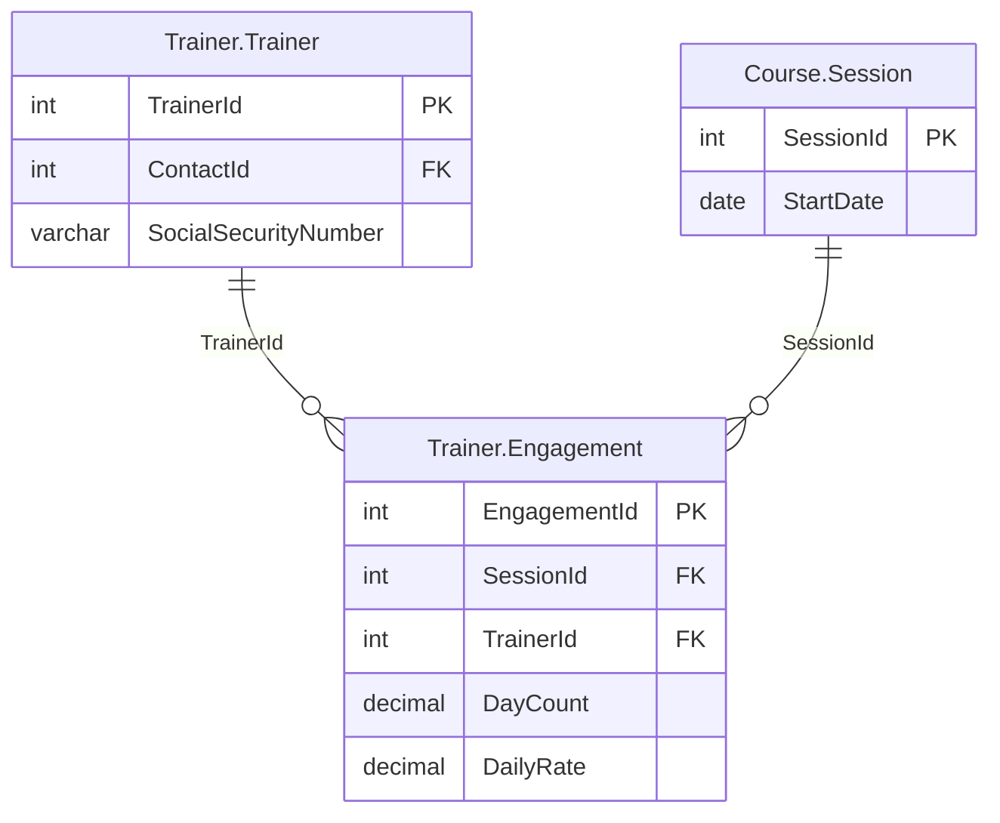

# Exercice du module 8

L'audit veut que le serveur ne lise plus que ce qu'il expose. À la fin du module, tous les
outils lisent les vues du schéma `Mcp`, sauf un : `trainer_load`, et le modèle de ressource
`pachatraining://trainer/{trainer_id}/month/{month}` qui l'appelle, lisent encore
`Trainer.Trainer`, `Trainer.Engagement` et `Course.Session`. Sous `mcp_reader`, ils
échouent. À vous de leur donner leur vue.

## Le départ

Partez de la fin du module, votre branche `module-08`, ou l'étiquette du dépôt :

```bash
git switch -c exercise-08 module-08-end
uv sync
uv run python setup/use_account.py mcp_reader
```

La dernière commande fait passer le serveur sur `mcp_reader` dans votre `.env`, sans afficher
de mot de passe. Le labo doit tourner (`./setup/install.sh`, puis
`uv run python setup/check_lab.py`, qui finit par `lab ok`). Sous `mcp_reader`,
`uv run pytest -q` rend `4 failed, 38 passed` : les quatre tests de `trainer_load` et de la
ressource du formateur.

## La demande

1. Dans `setup/mcp-schema.sql`, une vue `Mcp.TrainerMonth`, créée par `CREATE OR ALTER VIEW`
   comme les autres, avec quatre colonnes :

   | Colonne | Contenu |
   |---|---|
   | `TrainerId` | le formateur |
   | `Month` | le mois de début des sessions, écrit `YYYY-MM` (`2026-10`) |
   | `SessionCount` | le nombre d'engagements du formateur dans les sessions qui commencent ce mois-là |
   | `DayCount` | les jours facturés pour ces engagements |

   Un formateur qui existe et n'a aucun engagement doit y figurer aussi : sans cela, le serveur
   ne distingue plus un formateur sans activité d'un formateur inconnu. Une ligne dont `Month`
   est `NULL` convient.
2. Relancez `./setup/install.sh` (avec Podman :
   `COMPOSE="podman compose" ENGINE=podman ./setup/install.sh`) : il rejoue
   `setup/mcp-schema.sql` sur `PachadataTraining`, en `sa`. Le `GRANT SELECT ON SCHEMA::Mcp`
   déjà posé couvre la nouvelle vue : n'accordez rien d'autre à `mcp_reader`.
3. Dans `src/pachatraining_mcp/server.py`, `trainer_load` lit `Mcp.TrainerMonth` et plus
   aucune table. Ses réponses ne changent pas : le formateur 38 en octobre 2026, 3 sessions
   et 6,0 jours ; un formateur inconnu, `Trainer 999 not found.` ; un formateur sans
   engagement, zéro. Le modèle de ressource appelle toujours `trainer_load`.
4. Aucun mot de passe dans le code ni dans un fichier que git verrait : la connexion se lit
   dans `.env`.
5. Toute la suite passe sous `mcp_reader` (`uv run pytest -q`).



## Le critère

```bash
bash exercises/module_08/check.sh
```

Le script lance pytest sur `exercises/module_08/test_least_privilege.py`, avec le client du
SDK en mémoire, sans modèle ni Node, en une dizaine de secondes. Il attend cinq tests passés
et échoue sur tout autre nombre :

1. le serveur se connecte en `mcp_reader`, et la suite de `tests/` passe en entier sous ce
   compte (42 tests au moins, aucun échec, aucun saut) ;
2. `Mcp.TrainerMonth` est une vue, et elle donne 3 sessions et 6,0 jours au formateur 38 en
   octobre 2026 ;
3. le formateur 3, qui existe et n'a aucun engagement, rend zéro par l'outil et par la
   ressource ; le formateur 999 rend `Trainer 999 not found.` par l'outil et -32602 par la
   ressource ;
4. le code de `src/pachatraining_mcp/` ne nomme, après `FROM`, `JOIN`, `INTO`, `UPDATE` ou
   `EXEC`, aucun objet hors du schéma `Mcp`, et aucun fichier que git verrait ne contient un
   mot de passe de `.env` ;
5. `mcp_reader` n'a que `CONNECT`, `SELECT` sur le schéma `Mcp` et `EXECUTE` sur ses deux
   procédures, n'est membre d'aucun rôle, ne voit aucune table ni vue hors de `Mcp`, et une
   lecture de `Contact.Contact` lui rend l'erreur 229.

La dernière ligne doit être `All 5 checks passed.` Une solution est dans
`exercises/module_08/solution/` ; `solution/tests/test_least_privilege.py` reprend dans la
suite les contrôles 2 à 5.

---

# Module 8 exercise

The audit wants the server to read only what it exposes. At the end of the module, every tool
reads the views of the `Mcp` schema but one: `trainer_load`, and the resource template
`pachatraining://trainer/{trainer_id}/month/{month}` that calls it, still read
`Trainer.Trainer`, `Trainer.Engagement` and `Course.Session`. Under `mcp_reader`, they fail.
Give them their view.

## Starting point

Start from the end of the module, your `module-08` branch, or the tag of the repository:

```bash
git switch -c exercise-08 module-08-end
uv sync
uv run python setup/use_account.py mcp_reader
```

The last command moves the server to `mcp_reader` in your `.env`, without printing a
password. The lab must be running (`./setup/install.sh`, then
`uv run python setup/check_lab.py`, which ends with `lab ok`). Under `mcp_reader`,
`uv run pytest -q` gives `4 failed, 38 passed`: the four tests of `trainer_load` and of the
trainer resource.

## What to do

1. In `setup/mcp-schema.sql`, a view `Mcp.TrainerMonth`, created by `CREATE OR ALTER VIEW` like
   the others, with four columns:

   | Column | Content |
   |---|---|
   | `TrainerId` | the trainer |
   | `Month` | the month the sessions start in, written `YYYY-MM` (`2026-10`) |
   | `SessionCount` | the engagements of the trainer in the sessions that start that month |
   | `DayCount` | the days billed for those engagements |

   A trainer who exists and has no engagement must appear too: otherwise the server can no
   longer tell an idle trainer from an unknown one. A row whose `Month` is `NULL` will do.
2. Run `./setup/install.sh` again (with Podman:
   `COMPOSE="podman compose" ENGINE=podman ./setup/install.sh`): it runs
   `setup/mcp-schema.sql` on `PachadataTraining` again, as `sa`. The
   `GRANT SELECT ON SCHEMA::Mcp` already in place covers the new view: grant nothing else to
   `mcp_reader`.
3. In `src/pachatraining_mcp/server.py`, `trainer_load` reads `Mcp.TrainerMonth` and no table
   any more. Its answers do not change: trainer 38 in October 2026, 3 sessions and 6.0 days;
   an unknown trainer, `Trainer 999 not found.`; a trainer without engagements, zero. The
   resource template still calls `trainer_load`.
4. No password in the code nor in any file git would see: the connection is read from `.env`.
5. The whole suite passes under `mcp_reader` (`uv run pytest -q`).

## The check

```bash
bash exercises/module_08/check.sh
```

The script runs pytest on `exercises/module_08/test_least_privilege.py`, with the SDK client
in memory, without a model or Node, in about ten seconds. It expects five passed tests and
fails on any other number:

1. the server connects as `mcp_reader`, and the whole suite of `tests/` passes under that
   account (at least 42 tests, no failure, no skip);
2. `Mcp.TrainerMonth` is a view, and it gives trainer 38 3 sessions and 6.0 days in October
   2026;
3. trainer 3, who exists and has no engagement, gives zero through the tool and through the
   resource; trainer 999 gives `Trainer 999 not found.` through the tool and -32602 through
   the resource;
4. the code under `src/pachatraining_mcp/` names, after `FROM`, `JOIN`, `INTO`, `UPDATE` or
   `EXEC`, no object outside the `Mcp` schema, and no file git would see holds a password of
   `.env`;
5. `mcp_reader` has only `CONNECT`, `SELECT` on the `Mcp` schema and `EXECUTE` on its two
   procedures, belongs to no role, sees no table or view outside `Mcp`, and reading
   `Contact.Contact` gives it error 229.

The last line must be `All 5 checks passed.` A solution is in `exercises/module_08/solution/`;
`solution/tests/test_least_privilege.py` brings checks 2 to 5 into the suite.
